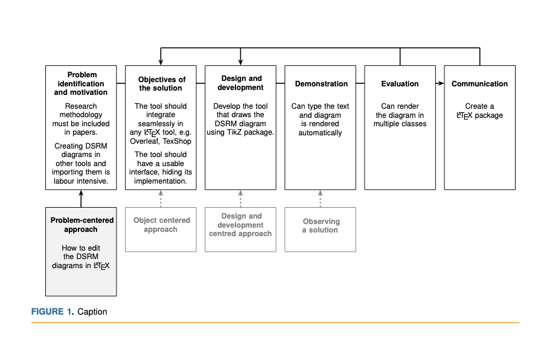
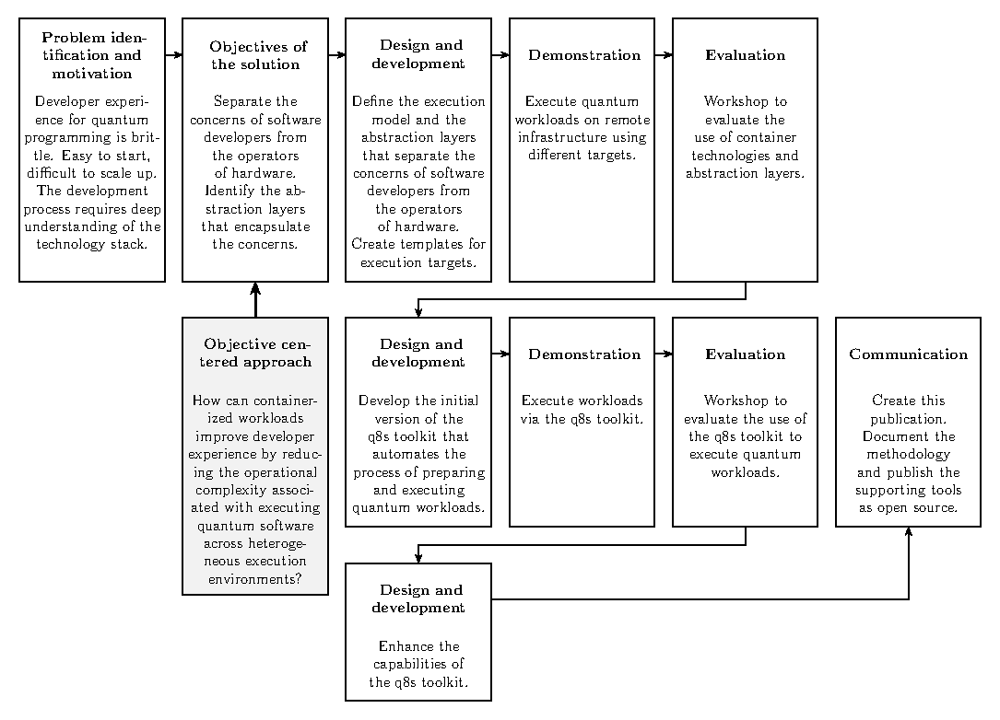

# Design Science Research methodology in Latex

This a package that allows you to create Design Science Research diagrams in Latex.

## Installation

Copy the `dsrm.sty` to your project.

## Usage

Write the text

```latex
\DSR{
    \ProblemIdentification[How to edit the DSRM diagrams in \LaTeX]{Research methodology must be included in papers.\\\vspace{8pt}Creating DSRM diagrams in other tools and importing them is labour intensive.}
    \ObjectivesOfTheSolution{The tool should integrate seamlessly in any \LaTeX\ tool, e.g. Overleaf, TexShop\\\vspace{8pt}The tool should have a usable interface, hiding its implementation.}
    \DesignAndDevelopment{Develop the tool that draws the DSRM diagram using TikZ package.}
    \Demonstration{Can type the text and diagram is rendered automatically}
    \Evaluation{Can render the diagram in multiple classes}
    \Communication{Create a \LaTeX\ package}
}
```

gives this result in IEEE Computer Science magazines projects:



Phase boxes automatically share the height needed by the tallest phase body,
with a minimum height of 3cm and padding beneath the text. Titles and connectors
move with the shared height. Each diagram is measured independently, so multiple
diagrams in one document can have different heights. Optional input boxes
continue to size themselves independently. An input box and its arrow appear
only when optional input text is supplied, for example
`\ProblemIdentification[Input text]{Phase text}`. Omitting the optional argument
or passing `[]` leaves that input box out.

To show gray placeholders with dashed arrows for empty inputs, enable the
`showemptyinputs` package option:

```latex
\usepackage[showemptyinputs]{dsrm}
```

You can also switch this flag in the document with `\dsrmshowemptyinputstrue`
and `\dsrmshowemptyinputsfalse` before `\DSR{...}`. Wrap the switch and diagram
in `\begingroup ... \endgroup` to apply it locally. Inputs containing text
always render normally, regardless of the flag.

Phase bodies are typeset once for measurement and again for drawing. Avoid
commands with side effects, such as counter increments, inside phase text.

## Iterations

Use `\DSRIterations` with an `\Iteration` for each row. Reuse the same phase
commands, in methodology order, and include only the phases needed in that row:

```latex
\DSRIterations{
    \Iteration{
        \ProblemIdentification{Identify the problem.}
        \ObjectivesOfTheSolution[Starting point]{Define the objectives.}
        \DesignAndDevelopment{Develop the initial solution.}
        \Demonstration{Demonstrate the solution.}
        \Evaluation{Evaluate the initial solution.}
    }
    \Iteration{
        \DesignAndDevelopment{Improve the solution.}
        \Demonstration{Demonstrate the improvements.}
        \Evaluation{Evaluate the improvements.}
        \Communication{Publish the results and supporting tools.}
    }
    \Iteration{
        \DesignAndDevelopment{Make the final refinements.}
    }
}
```

Phase columns stay aligned across rows. Each row sizes itself to its tallest
phase and connects its phases from left to right. A feedback arrow connects the
last phase of each row to the first phase of the next row. Optional inputs and
`showemptyinputs` work here too; rows move down as needed to leave room for input
boxes and feedback arrows.

Include `\Communication` once, on the row where you want it displayed. The final
iteration connects to it, including an upward connection when communication is
on an earlier row. Communication is excluded from the intermediate feedback
chain. Each row must contain at least one other phase, and each phase can appear
at most once per row. Omit communication to draw only the iteration chain.

The complete [iteration example](tests/iterations/test.tex) produces:



## Paper-to-DSR skill

The reusable agent skill lives in [skills/paper-to-dsr](skills/paper-to-dsr/SKILL.md).
It includes evidence-mapping guidance, the rendering package and its license, and
working templates for single-pass and iterative diagrams. Supply the full skill
folder and the paper to your agent. A suitable task is:

> Use the paper-to-dsr skill to create a DSR diagram from this paper. Deliver the
> LaTeX source, rendered PDF, and a mapping from diagram content to paper evidence.

The canonical rendering package remains the root `dsrm.sty`. After changing it
or the license, refresh the skill's bundled assets before committing or releasing:

```sh
python3 scripts/sync_skill_assets.py
```

The test suite checks that bundled assets match their originals and compiles
both skill templates. The skill's own version is recorded in its `SKILL.md`
metadata and can change independently of the package version.

The skill instructions, references, agent metadata, templates, and asset-sync
helper use the [MIT license](skills/paper-to-dsr/LICENSE). The rendering package
retains its existing [LPPL license](LICENSE), also bundled separately as
[LICENSE-LPPL](skills/paper-to-dsr/assets/LICENSE-LPPL). The skill's MIT license
does not relicense `dsrm.sty`.

## Tests

Run the automated suite from the project root:

```sh
python3 -m unittest discover -s tests -v
```

GitHub Actions runs this suite on every push and pull request. You can also
run the Tests workflow manually from the Actions tab.

Requires Python 3 and `pdflatex` on your PATH, with the LaTeX packages used
by the examples installed (including TikZ, standalone, and the dependencies
of the bundled IEEE class). No additional Python packages are needed.

The suite compiles the article, standalone, and IEEE examples, exercises
all four optional phase inputs with wrapped and formatted text, and checks
that input boxes grow with their content while preserving width and bottom
padding. It also checks that any of the six phases can set the shared phase
height and that subsequent diagrams reset their height. Iteration tests cover
the example, column alignment, row heights, and clearance around inputs.
Builds use temporary
directories and leave the example files untouched.
These checks verify compilation and geometry; visual styling still needs review
of the rendered PDF.
